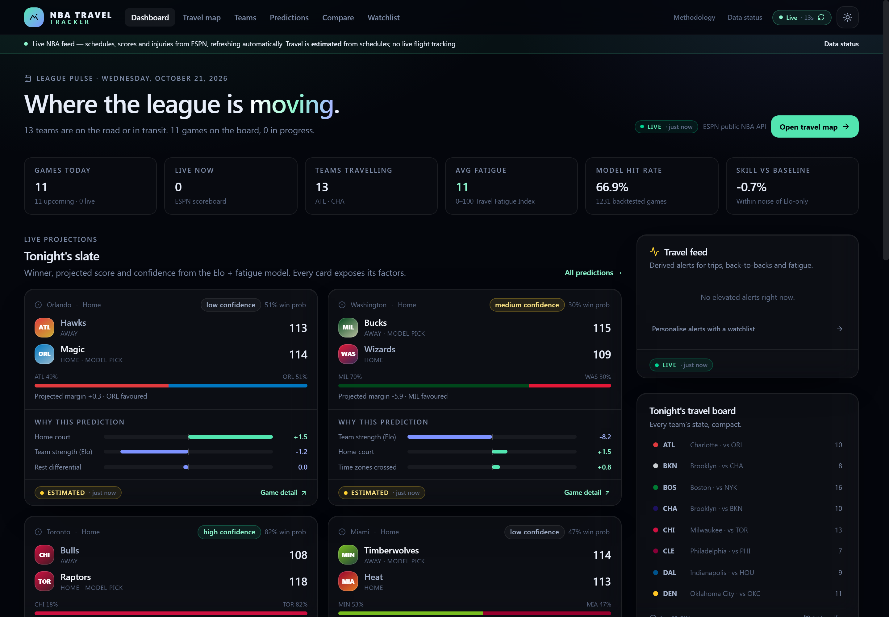
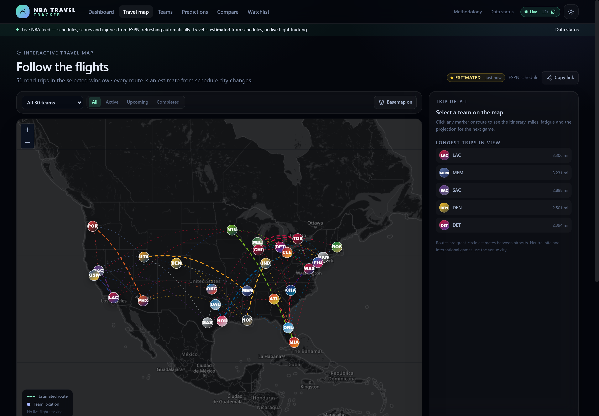
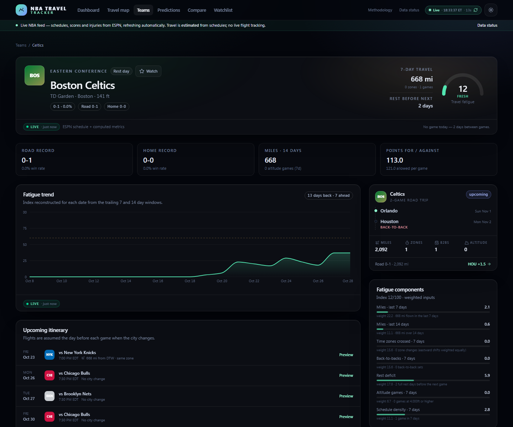
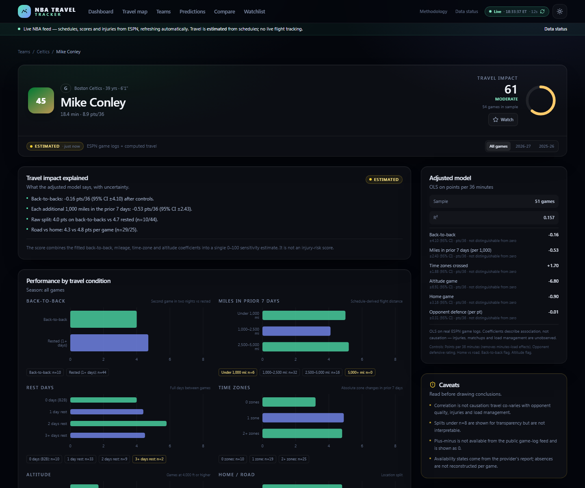
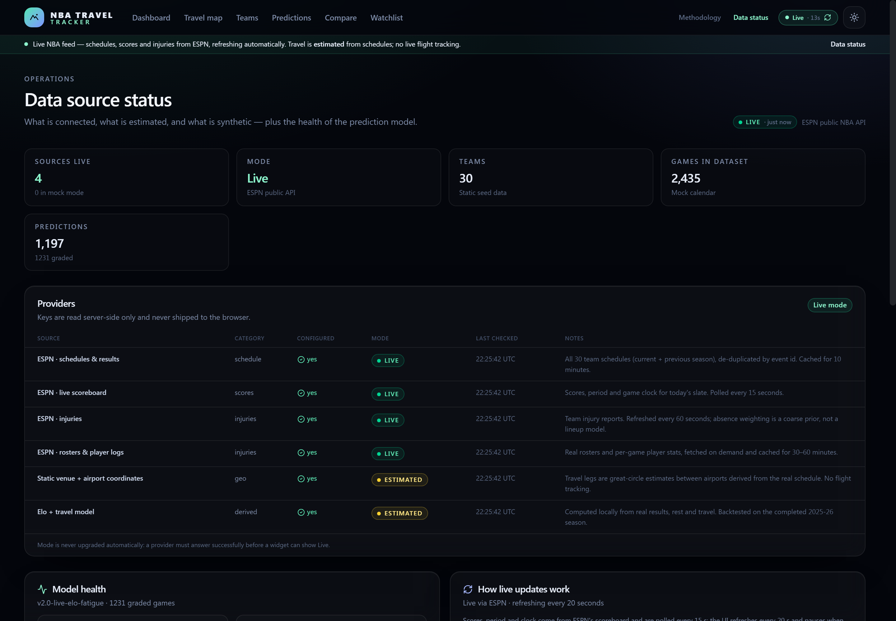
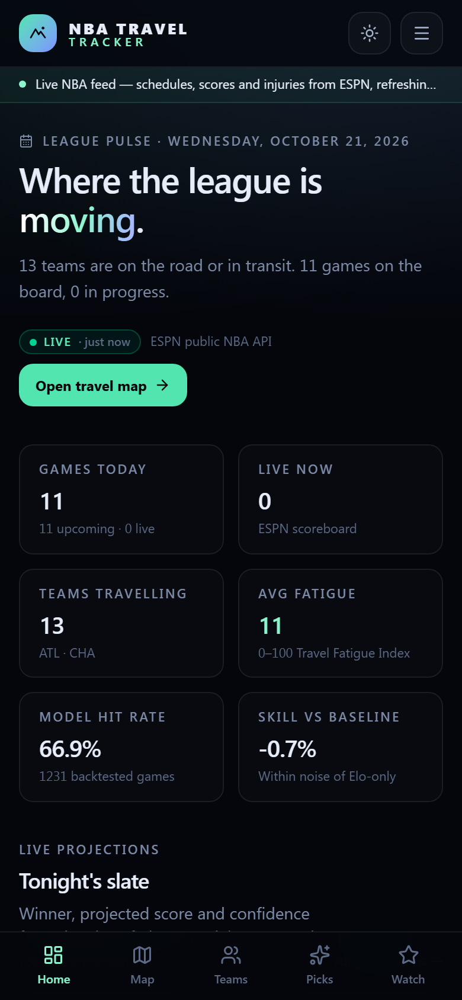

# NBA Travel Tracker

Travel, fatigue and transparent game projections for all 30 NBA teams — a working Next.js app with **live NBA data**, an interactive travel map, explainable predictions and player-level travel splits.



> **Live data.** Schedules, scores, injuries, rosters and player game logs come from ESPN's public NBA endpoints and refresh automatically (scores every 20s). Team travel is **estimated** from those schedules and airport coordinates — never live flight tracking. Predictions are informational, not betting advice. Every widget labels its provenance (`Live` / `Cached` / `Estimated` / `Mock`) and shows a last-updated time; if the live feed fails, the app falls back to a clearly labelled synthetic dataset.

```
Next.js 15 · React 19 · TypeScript · Tailwind CSS v4 · Framer Motion
Recharts · Leaflet / react-leaflet (no token required) · Zustand · React Query
```

---

## What it answers

1. **Where are teams traveling right now / next?** Dashboard status board, road-trip cards, interactive map with a 14-day scrubber.
2. **How do teams perform on the road, and does travel affect them?** Team pages with home/road splits, rest/altitude/back-to-back splits, fatigue trend.
3. **How has travel affected individual players?** Player pages with rest, mileage, time-zone and altitude splits, confidence intervals and an adjusted OLS model.
4. **What are tonight's projections?** Prediction cards with winner, projected score, confidence, factor attribution and an Elo-only baseline.
5. **How do I explore it spatially?** Map with team markers, animated estimated routes, filters, timeline, desktop side panel and mobile bottom sheet.
6. **How trustworthy is any of this?** Provenance badges everywhere, a `/methodology` page with formulas and edge cases, and a `/status` page for source health and model calibration.

---

## Screens

| Dashboard | Travel map |
| --- | --- |
|  |  |

| Team detail | Player travel impact |
| --- | --- |
|  |  |

| Data status | Mobile |
| --- | --- |
|  |  |

---

## Quick start

```bash
# Node 20.9+ required (developed on Node 24)
npm install

cp .env.example .env.local     # optional: no keys required
npm run dev                    # http://localhost:4310
```

Production:

```bash
npm run build
npm run start                  # http://localhost:4310
npm run smoke                  # end-to-end smoke test against the running server
```

`npm install` can run without network access to any data provider — the app has no runtime dependency on one.

### Scripts

| Script | What it does |
| --- | --- |
| `npm run dev` | Dev server on port 4310 |
| `npm run build` | Production build (type-checks too) |
| `npm run start` | Serve the production build |
| `npm run typecheck` | `tsc --noEmit` |
| `npm test` | Vitest unit suite (37 tests) |
| `npm run smoke` | HTTP smoke test across pages + APIs |

---

## Project structure

```
nba-travel-tracker/
├─ .env.example
├─ next.config.ts
├─ vitest.config.ts
├─ scripts/
│  └─ smoke.mjs                     # E2E smoke checks against a running server
├─ tests/
│  ├─ fatigue.test.ts               # index bounds, weights, monotonicity, bands
│  ├─ travel.test.ts                # haversine, trips, back-to-backs, time zones
│  ├─ predictions.test.ts           # link fn, factor directions, confidence, calibration
│  └─ player-impact.test.ts         # OLS recovery, sample gates, season filters
└─ src/
   ├─ app/
   │  ├─ layout.tsx                 # shell, theme bootstrap, metadata
   │  ├─ globals.css                # design tokens, glass, light mode, map styling
   │  ├─ page.tsx                   # dashboard
   │  ├─ map/page.tsx               # interactive travel map
   │  ├─ teams/page.tsx             # all 30 teams (search, filter, sort)
   │  ├─ teams/[id]/page.tsx        # team detail
   │  ├─ players/[id]/page.tsx      # player travel impact
   │  ├─ predictions/page.tsx       # slate + model performance
   │  ├─ games/[id]/page.tsx        # matchup + explanation
   │  ├─ compare/page.tsx           # compare mode
   │  ├─ watchlist/page.tsx         # favourites + alerts
   │  ├─ methodology/page.tsx       # formulas, edge cases, legal
   │  ├─ status/page.tsx            # data source health
   │  ├─ error.tsx | loading.tsx | not-found.tsx
   │  └─ api/
   │     ├─ teams/route.ts
   │     ├─ teams/[id]/travel/route.ts
   │     ├─ games/route.ts
   │     ├─ predictions/route.ts
   │     ├─ players/[id]/travel-impact/route.ts
   │     ├─ map/travel/route.ts
   │     └─ status/route.ts
   ├─ components/
   │  ├─ nav.tsx, footer.tsx, providers.tsx, motion.tsx
   │  ├─ ui.tsx                     # Card, Badge, Button, Stat, EmptyState…
   │  ├─ domain.tsx                 # provenance, team marks, gauges, prediction cards
   │  ├─ charts.tsx                 # Recharts wrappers (client)
   │  ├─ road-trip-card.tsx
   │  ├─ team-grid.tsx, compare-selector.tsx
   │  ├─ watch-button.tsx, watchlist-view.tsx
   │  └─ map/
   │     ├─ travel-map.tsx          # filters, timeline, panel, URL state
   │     └─ map-canvas.tsx          # Leaflet (dynamic, ssr:false)
   └─ lib/
      ├─ types.ts                   # domain model
      ├─ teams.ts                   # 30 real teams: arena, airport, tz, colours
      ├─ players.ts                 # synthetic rosters
      ├─ schedule.ts                # deterministic schedule + results engine
      ├─ travel.ts                  # legs, trips, windows
      ├─ geo.ts                     # haversine, arcs, endpoints
      ├─ time.ts                    # league dates, DST-aware tipoffs
      ├─ stats.ts                   # records, splits
      ├─ fatigue.ts                 # Travel Fatigue Index
      ├─ predictions.ts             # margin model, Elo, calibration
      ├─ model.ts                   # backtest report + skill score
      ├─ player-impact.ts           # logs, splits, OLS, impact score
      ├─ injuries.ts                # deterministic mock injury reports
      ├─ dataset.ts                 # assembly + per-minute cache + queries
      ├─ providers.ts               # provider registry / status
      ├─ map.ts                     # map payload types
      ├─ api.ts                     # JSON helpers, rate limit
      └─ rand.ts, utils.ts
```

---

## Data layer

### Provenance contract

Every payload carries a `meta` block:

```ts
interface DataMeta {
  provenance: "live" | "cached" | "estimated" | "mock";
  source: string;
  updatedAt: string; // ISO
  note?: string;
}
```

Rules enforced in the code:

- Live widgets only show `Live` after a successful fetch from ESPN in the current process.
- `Cached` means the payload came from the TTL cache and may lag; `Estimated` is travel geometry; `Mock` means the synthetic fallback is active.
- A failed refresh never upgrades a label, never fabricates a score, and falls back to the last good payload, then to the synthetic engine.
- `/status` and `/api/status` expose the same registry plus the fitted model coefficients.

### Providers

| Provider | Auth | State in this build |
| --- | --- | --- |
| ESPN public NBA JSON | none | **Primary live source**: schedules, scores/clock, injuries, rosters, player game logs |
| OpenStreetMap tiles | none | Real basemap in the browser; “no-token mode” renders without it |
| Synthetic engine | — | Automatic fallback when ESPN is unreachable (labelled Mock) |
| balldontlie / SportsDataIO / Sportradar | key | Optional adapters for a licensed deployment; not used by the default path |

Keys are read server-side only. Nothing secret is exposed to the client bundle — the map tile URL is the only `NEXT_PUBLIC_*` value and it is not a secret.

### Live data pipeline

```
ESPN scoreboard (15s) ─┐
ESPN injuries  (60s) ──┼─▶ normalise ─▶ dataset (15s cache) ─▶ RSC pages + /api
ESPN schedules (10m) ──┤                 │
ESPN rosters/logs (30m)┘                 └─ Elo replay ─▶ projections ─▶ backtest
```

- **Schedules & results** — all 30 team schedules for the current and previous season, de-duplicated by ESPN event id.
- **Live scores** — today's scoreboard overrides status, period, clock and scores every 15 seconds; the UI refreshes every 20 seconds and pauses when the tab is hidden. The header pill shows the exact data timestamp (e.g. `Live · 18:29:06 ET · 12s`) so freshness is visible, and the countdown resets on every refresh.
- **Auto-update, verified** — a headless-browser check confirmed the timestamp advancing from `18:28:46` to `18:29:06` with one new RSC request and no page reload.
- **Injuries** — team reports mapped to `out / doubtful / questionable / probable`; weighting in the model is a coarse prior, not a lineup model.
- **Rosters & player logs** — real athletes and per-game stats, fetched on demand and cached. Player pages join each game log to that team's schedule to compute rest, mileage, time zones and altitude.
- **Travel stays estimated** — routes are great-circle airport distances derived from the real schedule. No flight tracking is used or implied.

### What refreshes, and when

| Surface | Cadence | Limit |
| --- | --- | --- |
| Header timestamp, scores, dashboard slate, projections, team travel, map | ~20 s | Dataset cache 15 s, scoreboard 15 s |
| Injuries | ~20 s | Injury cache 60 s |
| Schedule changes (reschedules, new games) | ~20 s | Schedule cache 10 min |
| Player pages (splits, impact model) | ~20 s | Game logs cached 10 min; badge shows the log age |
| Team roster list | ~20 s | Roster cache 60 min |
| Static formula pages | n/a | Only the dataset timestamp changes |

Refreshes pause in hidden tabs and resume on focus. A manual click on the header pill forces an RSC refresh but does **not** bypass the provider caches above.

**Fallback.** If ESPN fails on a cold request, `getDataset()` logs the error, builds the deterministic synthetic season, flips every badge to `Mock`, and shows an explanatory banner. The app never silently mixes the two.

### Longevity

- **Seasons roll forward.** Season ids are derived from the date (Sep–Dec → next year, Jan–Jun → current, Jul–Aug → just-finished). No hardcoded "2026-27" in the live path.
- **Offseason safe.** If the next schedule is not published, the app falls back one season instead of dropping to mock mode; `/status` shows `Offseason mode: Yes`.
- **Live ledger.** The first pre-game projection for the next 48 hours is persisted to `.data/predictions.jsonl`, deduplicated by game + model version, and graded after the final buzzer. Accuracy and Brier appear on `/predictions` next to the historical backtest.
- **Map day rollover.** The map's default date follows the server's league date, so a tab left open overnight moves to the new day on refresh.
- **Not included:** playoffs. ESPN's team-schedule endpoint returns the regular season only; playoff games would need a separate feed.

**Performance.** A cold live build fetches ~90 schedule requests (three seasons × 30 teams) with bounded concurrency and completes in ~1–2s on a laptop; schedules then stay cached for 10 minutes. The assembled dataset is cached for 15 seconds, so refresh cost is one scoreboard + one injury request.

### Synthetic engine (fallback only)

The synthetic path is still fully implemented: seeded PRNG keyed by season/team/game, a plausible schedule, Elo-driven results, deterministic injuries and game logs. It exists so the app works offline, in tests, and when a public endpoint rate-limits — always labelled **Mock**.


---

## Travel modelling

- A **leg** is created whenever a team’s next game is in a different city.
- Distance = great-circle airport distance × 1.06 routing buffer (statute miles).
- Departure = day before the game; same day on a back-to-back.
- **Road trip** = one or more consecutive away games. A single away game is a one-game trip.
- **Rest days** = `dayGap − 1`, floored at 0. `0` therefore means a back-to-back.
- **Altitude** = venue ≥ 4,000 ft (Denver 5,280, Salt Lake City 4,226; Mexico City neutral game is flagged too).
- **Neutral / international**: neutral venue coordinates, no home-court term, longer legs, no passport/immigration modelling.
- **Postponed**: excluded from records, rest and fatigue windows; the replay appears as a new `-R` game with a `rescheduled` flag.

Everything above is surfaced as `Estimated` and documented on `/methodology`.

---

## Travel Fatigue Index

```
index = Σ weight × clamp(value / cap, 0, 1)       // weights sum to 100
```

| Input | Cap | Weight |
| --- | --- | --- |
| Miles, 7 days | 7,000 | 20 |
| Miles, 14 days | 12,000 | 10 |
| Time zones crossed, 7d | 4 | 14 |
| Back-to-backs, 7d | 2 | 14 |
| Rest deficit | 1 | 16 |
| Altitude games, 7d | 1 | 6 |
| Games, 7d | 4 | 10 |
| Projected minutes load | 1 | 10 |

Bands: `<20` fresh · `<40` manageable · `<60` elevated · `<80` high · `≥80` severe. It is a scheduling heuristic — not a medical or injury-risk model. Covered by `tests/fatigue.test.ts`.

---

## Prediction model

```
margin = intercept
       + β_elo   × (eloHome − eloAway)
       + β_home  × home (0 at neutral sites)
       + β_rest  × (restHome − restAway)        capped ±3.5
       + β_b2b   × (awayB2B − homeB2B)          capped ±4
       + β_miles × (awayMiles7 − homeMiles7)/1000 capped ±3
       + β_tz    × (awayZones7 − homeZones7)    capped ±2
       + β_alt   × altitude (visitor rested ≤ 1 day) else 0.45×
       + β_inj   × (awayInjuryPts − homeInjuryPts) capped ±6

P(home win) = Φ(margin / 11.5)
```

- **Fitted coefficients.** In live mode β is estimated by OLS on the season two years back (≈1,200 games) and evaluated **out-of-sample on the previous season**. Seasons are derived from the current date, so this rolls forward every year. If the fit fails validation, documented defaults are used. Current values are shown on `/status`.
- **Baseline:** the same expression without rest/travel/injury terms. Shown on every prediction card and graded on every completed game.
- **Confidence:** bucketed from the probability edge, games of evidence and lineup uncertainty. No decimal-place theatre — probabilities are rounded and clamped to 2–98%.
- **Explainability:** each term is returned as a factor with its point contribution and a human-readable detail string.
- **Backtesting:** the held-out previous season is replayed chronologically; each game is predicted with the Elo state *before* it, then Elo updates. This avoids look-ahead bias. Reports accuracy, Brier, log loss and a 10-bucket calibration curve. On the holdout season the fatigue terms land slightly *behind* Elo alone — the UI reports the negative skill instead of hiding it.
- **Live ledger:** the first pre-game projection for each game in the next 48 hours is persisted to `.data/predictions.jsonl` (deduplicated by game + model version) and graded once the game is final. The predictions page shows live accuracy and Brier alongside the historical backtest.
- **Persistence:** the history is recomputed deterministically per request rather than stored. Add Prisma/Postgres for a durable ledger (see Stretch).

Do not use this model for wagering.

---

## Player travel impact

Per player, per game: minutes, points, FG%, 3P%, turnovers, rest days, back-to-back flag, miles and zones in the prior 7 days, altitude flag, opponent defensive rating — all from real ESPN game logs joined to the real schedule.

- Splits by rest (0/1/2/3+), back-to-back, 4 mileage buckets, time zones, altitude and home/road.
- Every split reports `n`, mean points, and a 95% CI half-width; `n < 8` is flagged in the UI.
- Adjusted model: OLS of **points per 36** on back-to-back, mileage (per 1,000), zones, altitude, home/away, opponent defence. Requires ≥ 30 appearances; coefficients carry ±95% intervals and “not distinguishable from zero” labels.
- **Travel Impact Score** (0–100) shrinks those coefficients by their standard errors and prices a heavy travel scenario — a communication device, not a new statistic.
- Plus-minus is not in the public game-log feed and is shown as 0; trades are handled by resolving each log against the team the player actually played for that season.

Caveats are rendered next to the numbers: correlation ≠ causation, unobserved injuries, matchup and load-management effects.

---

## API

All JSON routes are `GET`, cached (15–60 s), rate limited per instance, and include `meta`:

| Route | Returns |
| --- | --- |
| `/api/teams` | 30 teams + travel metrics + next game + projection |
| `/api/teams/:id/travel` | Metrics, trips, legs, provenance |
| `/api/games?date=YYYY-MM-DD` | Games for a league date, with predictions |
| `/api/predictions?date=YYYY-MM-DD` | Projections + model report summary |
| `/api/players/:id/travel-impact?season=all\|current\|previous` | Splits, model, logs |
| `/api/map/travel?date=&team=` | Map payload (teams, trips, routes) |
| `/api/status` | Provider registry, counts, model health |

Unknown team/player → `404` with `{ error }`. Invalid dates → `400`.

---

## Testing & quality

- **46 unit tests** covering season rollover, ledger grading, the fatigue formula, travel geometry/trip grouping, the prediction model (directions, bounds, calibration, Elo), and the player-impact OLS + sample gates.
- **`npm run smoke`** checks 19 endpoints (11 pages, 8 API routes) against a running production build, including a 404 case.
- **CI** (`.github/workflows/ci.yml`) runs install, typecheck, unit tests and a production build on every push and pull request, with `FORCE_MOCK_DATA=true` so the build never depends on ESPN being reachable.
- **Accessibility:** skip link, semantic landmarks, `aria-current` nav state, `aria-pressed` toggles, labelled form controls, visible focus rings, `aria-label`s on icon-only buttons, gauges exposed as `role="img"` with values, colour never the only signal.
- **Reduced motion:** Framer Motion entrances and Recharts animations are disabled via `prefers-reduced-motion`; CSS animations are neutralised globally.
- **Performance:** map and charts are client-only, Leaflet is dynamically imported, route data is server-rendered, and chart/map bundles stay off every other page.
- **Error/empty/loading:** `error.tsx`, `loading.tsx` skeletons, explicit empty states on every list, map fetch failure falls back to the last payload.

---

## MVP vs stretch

**Shipped (MVP)**

- Dashboard with today's slate, live/final scores, travel statuses, road-trip cards, fatigue leaders, alerts.
- Interactive map: 30 markers, estimated animated arcs, team/status/date filters, 14-day scrubber with play, URL-shareable state, desktop panel + mobile detail panel that scrolls into view, cluster view at low zoom, no-token mode, legend, estimated-data disclosure.
- Team pages: itinerary, road/home splits, rest/altitude/back-to-back splits, fatigue trend, real roster linking to per-player impact, upcoming projections.
- Player pages: 6 split families, CIs, sample warnings, adjusted model, caveats, season filter.
- Predictions: cards, factor attribution, baseline, confidence, calibration, backtest table.
- Watchlist + in-app alerts (localStorage), compare mode, methodology, status, 404/error/loading.

**Stretch (not implemented, clearly marked)**

- WebSocket/push alerts and email digests.
- Durable prediction ledger + Postgres/Prisma; user accounts.
- Historical season replay and prediction backtesting dashboard over multiple seasons.
- Compare mode for player-vs-player across seasons; composite trip-difficulty score.
- Licensed provider adapters (the public ESPN feed is what ships today), betting odds, and a paid injury feed with lineup-level detail.
- Map marker decluttering beyond the East/West cluster fallback; airport-to-arena routing.

---

## Limitations

- Live data comes from ESPN's public, undocumented endpoints — no SLA, possible rate limits, and ESPN's terms apply. A commercial deployment should use a licensed provider.
- Travel ignores charter specifics, delays, ground transfer and immigration; it is a schedule-derived estimate.
- Injury weighting is a coarse availability prior (out ≈ 1.4 pts, questionable ≈ 0.5), not a lineup or minutes model; historical injuries are not backfilled for the fit season.
- The fitted model does not beat the Elo baseline out-of-sample; the UI reports that honestly.
- The prediction ledger is file-backed (`.data/`), falling back to memory on read-only hosts such as Vercel.
- Plus-minus is unavailable from the public game-log feed and is shown as `—`.
- Player samples cover the regular season only: ESPN's team-schedule endpoint does not return playoff games, so playoff box scores are not joined.
- Time-zone math uses standard UTC offsets and ignores daylight saving; Phoenix/Denver edges can be off by one zone in summer.
- The live fatigue index omits the minutes component (no cheap box score) and renormalises the remaining weights.
- No database: watchlists live in `localStorage`, predictions are recomputed, and the hot cache is per process.
- Rate limiting is in-memory per instance.

---

## Data sources & attribution

| Source | Provides | Notes |
| --- | --- | --- |
| [ESPN public NBA endpoints](https://www.espn.com/nba/) | Schedules, scores, injuries, rosters, player game logs | No key required; undocumented and subject to ESPN's terms. Not affiliated or endorsed. |
| [OpenStreetMap](https://www.openstreetmap.org/copyright) | Basemap tiles | © OpenStreetMap contributors, ODbL. The app also renders without tiles. |
| Static seed data (`src/lib/teams.ts`) | Arena/airport coordinates, time zones, altitudes | Hand-curated; see limitations. |

ESPN is not a licensed data partner for this project. Before commercial use, replace the adapter in `src/lib/providers/espn.ts` with a provider contract.

---

## Legal & disclaimers

- **Not affiliated** with or endorsed by the NBA, its teams, or ESPN. Team names, nicknames, arena names and colours are trademarks of their owners. No team logos, wordmarks or player photos are used; player names appear only as factual roster data.
- **Data terms:** ESPN's public endpoints are used for live schedules, scores, injuries, rosters and game logs. Review ESPN's terms before any production or commercial use.
- Basemap tiles © OpenStreetMap contributors (ODbL).
- **Privacy:** no accounts, no analytics, no tracking cookies. Watchlist and theme are stored in your browser only.
- **Not betting advice.** Probabilities are illustrative, uncertainty is wide, and past accuracy does not imply future results.

---

## Deploy to Vercel

1. Push the repository to GitHub and import it in Vercel.
2. Framework preset: Next.js. Build: `npm run build`. No environment variables are required — live data needs no key.
3. Optional: `NEXT_PUBLIC_SITE_URL`, `NEXT_PUBLIC_MAP_TILE_URL`, or `FORCE_MOCK_DATA=true` for a deterministic demo.
4. Serverless note: the 15-second dataset cache and in-memory rate limiter are per-instance, so a cold instance refetches ~90 schedules (~1–2s). Put the cache in Redis/KV and add a durable prediction table for production traffic.

---

## License

Application code is released under the [MIT License](LICENSE). That does not
cover NBA trademarks, team marks or ESPN data, which remain subject to their
owners' terms.

## Contributing

Issues and pull requests are welcome — see [CONTRIBUTING.md](CONTRIBUTING.md)
for setup, checks and the data-honesty rules. Security reports should follow
[SECURITY.md](SECURITY.md).

---

## Troubleshooting

| Symptom | Fix |
| --- | --- |
| Map is blank | Toggle “No-token mode” off/on; check the tile URL. Leaflet needs the client — it is dynamically imported. |
| `Mock` badges everywhere | ESPN was unreachable and the synthetic fallback engaged. Check `/status` and the server log. |
| Stale scores | The dataset cache is 15s and the UI refreshes every 20s; a hidden tab pauses refreshing until it is visible again. |
| Dates look off | League dates use America/New_York; tipoffs are stored as UTC and formatted in the venue zone. |
| Build fails on `next lint` | This project uses `tsc --noEmit` for type checks; there is no ESLint config dependency. |
